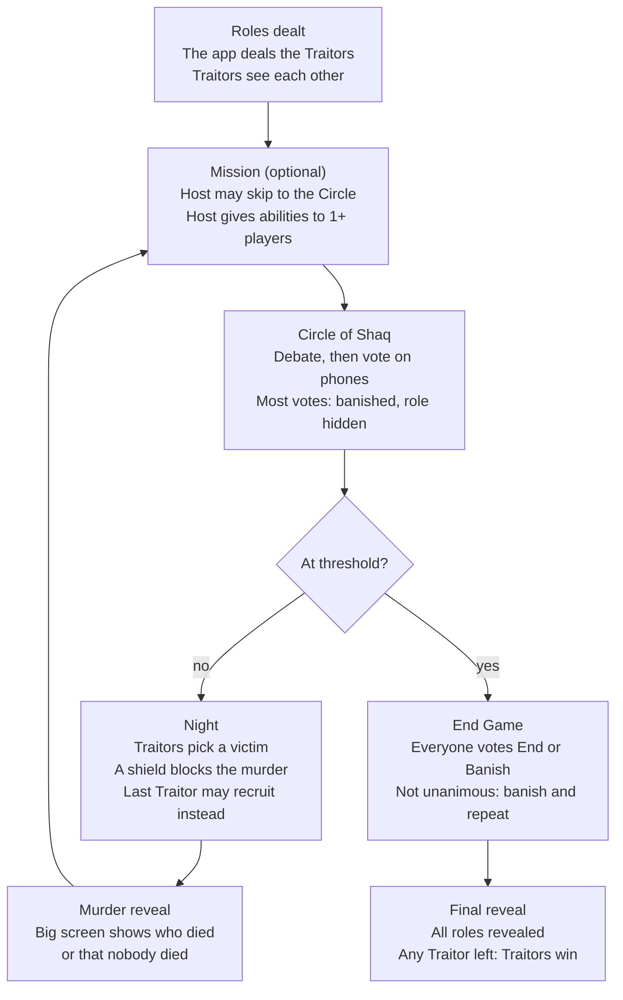

# Traitors: The Game — Project Context

> **Read this first.** This file is the single source of truth for what this app is, every decision made and why, the full rules, the architecture, and how to extend it. Anyone picking up the project, human or AI, should be able to work from this file alone.
>
> **Keep it current.** Update this file in the same commit as any change to rules, settings, schema, scope or decisions. Add new decisions to the decision log (section 14) with a date and a reason.

| | |
| --- | --- |
| Owner | Monarch Solanki (host of the first game) |
| Last updated | 26 October 2026 |
| Status | Step 0 (setup) in progress: Next.js scaffold and Diwali placeholder page committed; planning doc merged into this file. Next: GitHub, Supabase and Vercel. |
| First game | Diwali x Halloween ("Diwaloween: Lights & Frights") villa party, Saturday 31 October 2026, 12 players plus the host |
| Planning doc | [Traitors Party App — Build Plan](https://claude.ai/artifact/4t3XeWf8tHKf7C9YoMmDqN); fully merged into this file on 26 October 2026, so this file alone is enough |
| Party plan | [Diwaloween: Lights & Frights](https://claude.ai/artifact/CQQEuafHxQKbXXnHigSMes) |
| Local folder | `/Users/monarchsolanki/Traitors-The Game` (note the space; quote the path) |
| Repo | GitHub, private, `traitors-the-game` |
| Hosting | Vercel (app) + Supabase (database, realtime, auth, storage) |

## Contents

1. What this is
2. Glossary
3. How our game differs from the show
4. Customization and settings
5. Rules specification (authoritative)
6. Run sheet for the first game
7. Mission catalogue
8. Ghost mode
9. Architecture
10. Project structure
11. Version 1 scope tiers
12. Build plan
13. Testing
14. Decision log
15. External review (26 October)
16. Open decisions
17. Ideas for later
18. Setup and deploy
19. How to extend
20. Known limits and risks
21. Sources

---

## 1. What this is

A phone-first web app that runs an in-person game of **The Traitors**, based on the Indian version of the reality show (Prime Video, hosted by Karan Johar; Season 2 began streaming 13 August 2026). Players sit in the same room. The app replaces shoulder taps, paper ballots and secret rooms:

- **Players** use their own phones to see their secret role, vote at the Circle of Shaq, and use any shield or dagger they win.
- **Traitors** pick their murder victim and chat privately on their phones, so nobody has to sneak off.
- **The host** runs every phase from one control screen, records mission results, hands out rewards, and can edit every setting, player, name and photo.
- **A big screen** (laptop or TV) shows the dramatic parts to the room: murder reveals, the vote-by-vote reveal, the photo wall and the final reveal.

Nobody installs anything: everyone opens a link or scans a QR code, and joins with the room code. The party's physical games (charades, Mystery Box, Housie and the rest) double as missions, so the whole night feeds into one Traitors game. The game is sized for 10 to 12 players and 1 host by default, lasts as many days as it takes to finish, lives in one GitHub repo that deploys to Vercel, and uses Supabase like Omertà. Everything is customizable by the host, and version 1 is built tier by tier, in Claude Code, from this file, starting 26 October 2026.

This is a separate project from Omertà (the owner's Mafia game-master app), built on the same stack.

**Priorities, in order:**

1. One complete, reliable game on the night.
2. No accidental leaks of secret information.
3. Everything customizable by the host.
4. Drama and polish.

### 1.1 How the show works (The Traitors India)

The Indian version follows the global format with its own names and a few extra twists. It's hosted by Karan Johar at Suryagarh Palace in Jaisalmer, and Season 2 started streaming on 13 August 2026 ([Amazon](https://www.aboutamazon.in/news/entertainment/the-traitors-prime-video-reality-show)).

- **Roles:** the host secretly picks a few Traitors; everyone else is an Innocent ([Wikipedia](https://en.wikipedia.org/wiki/The_Traitors_India)).
- **Night:** the Traitors meet in a secret tower and murder one Innocent, who leaves the game at once.
- **Missions:** daytime tasks grow the prize pot, which was ₹1 crore in Season 2. Some missions award a shield, which protects against the next murder ([Northeast Times](https://northeasttimes.com/?p=161419)).
- **Circle of Shaq:** the show's Round Table. Players debate, vote privately, and the banished player reveals their role.
- **Dagger:** new in Season 2. Its holder's vote counts twice at the Circle ([filmeshilmy](https://www.filmeshilmy.com/2026/08/19/the-traitors-india-season-2-death-cards-daggers-and-tables-begin-to-turn/)).
- **Armoury missions:** players choose between adding money to the pot and winning access to the armoury, where the shield and dagger sit.
- **Recruitment:** Traitors can recruit an Innocent instead of murdering. The offer can be refused; Nikita turned it down in Season 1 ([Wikipedia](https://en.wikipedia.org/wiki/The_Traitors_India)).
- **Season 2 twists:** a death-card game where endangered players swap cards and the death-card holder is murdered, a Destiny Card that can reverse a banishment, and a wildcard re-entry ([filmeshilmy](https://www.filmeshilmy.com/2026/08/26/the-traitors-india-season-2-masks-begin-to-slip-as-new-powers-dramatically-shift-the-game/)).
- **End Game:** after the final Circle, players can end the game only by a unanimous vote; otherwise they banish again. If even one Traitor survives, the Traitors take the whole pot ([Northeast Times](https://northeasttimes.com/?p=161419)).

### 1.2 What others have built

Nothing ready-made fits an in-person, 3-hour game run on phones with shields and daggers, so we build our own and borrow the best ideas below.

| App | What it is | What we borrow |
| --- | --- | --- |
| [Traitors web app](https://traitors.samjam.duckdns.org/rules/) | Free web game master: the host starts a game, players join with a code, and the app picks the Traitors | Room-code joining, auto-dealt roles, and an End Game that needs every player's vote to finish |
| [The Traitors: Anywhere](https://www.pocketgamer.biz/citydays-and-all3media-team-up-to-launch-the-traitors-game-on-whatsapp/) | Official game played over WhatsApp for up to 30 players across a week; UK and Ireland only | Private host-to-player messages for secrets, with group discussion kept in the room |
| [The Traitors: Interactive Game](https://www.pocketgamer.com/the-traitors-interactive-game/out-now/) | Single-player mobile game against computer characters | Nothing; it isn't multiplayer |
| [Dash workplace guide](https://www.dash.app/blog/the-traitors-workplace-game) | How a company ran Traitors over Slack | A private Traitors channel, a spectator space for eliminated players, quizzes as shield missions |
| [Supabase quiz demo](https://plushcap.com/content/supabase/blog/supabase-meetup-kahoot-alternative) and [Tr1via](https://github.com/Vyntechs/Tr1via.com) | Open-source live games on Next.js and Supabase | One host action updates three synced screens (host, big screen and player phones); anonymous sign-in |

### 1.3 What this file covers

This file is the project memory, kept at the repo root so another person or AI can pick up the project cold and extend it. It is updated in the same commit as every change, so it never drifts from the code. It covers:

- What the app is, who it's for, and the party it was built for
- The decision log: every decision, the reason behind it, and the date
- Pending decisions, open questions and external review outcomes
- The rules specification, host settings, scope tiers and run sheet
- Architecture: the three views, data model, phase flow, and how secrets stay private
- The look and feel (9.8)
- How to extend it: adding an item, a phase, a ghost game or a setting
- Setup, environment variables and deploy steps
- Known limits and ideas for later

It merges the earlier planning doc ("Traitors Party App — Build Plan", 26 October 2026) into one file; nothing from that doc was dropped (decision log, 26 October).

---

## 2. Glossary

| Term | Meaning |
| --- | --- |
| Innocent | The majority role. Wins by banishing every Traitor. |
| Traitor | The secret minority. Wins if any Traitor survives to the end. |
| Host | Runs the game, sees everything, is not a player. |
| Co-host | Optional. Runs missions and the big screen, never sees roles. |
| Circle of Shaq | The group debate and vote; the Indian show's name for the Round Table. |
| Banishment | Removal by a Circle vote. |
| Murder | Removal by the Traitors at night. |
| Ghost | A murdered or banished player. Stays at the party and keeps using the app in ghost mode. |
| Ghost vote | Each ghost's single vote, cast at one later standard Circle, once per game. The only ghost power. |
| Shield | Mission reward. Blocks a murder against its holder for one night. |
| Dagger | Mission reward. Makes its holder's ballot count 2 times (or 3, if the host sets it) at one Circle. |
| Ability | A shield or a dagger, given by the host to one or more players after a mission. |
| Mission | An optional physical party game. After roles are dealt and after any murder reveal, the host decides whether to run one, several or none. |
| Day | One loop: murder reveal (from day 2), optional missions, Circle, night. There is no limit on the number of days. |
| End Game | The final stage. Players vote End or Banish until the vote is unanimous or 2 players remain. |
| Recruitment | Optional. The last Traitor may turn an Innocent into a Traitor instead of murdering. |
| Suspect poll | A decoy question Innocents answer at night, so every phone looks busy. |
| Big screen | The public display. It never shows a secret. |
| Seat | A player's slot in the game, claimed by tapping their photo and setting a PIN. |

---

## 3. How our game differs from the show

| Show | Our game | Why |
| --- | --- | --- |
| Banished players reveal their role | Roles stay hidden until the final reveal, for murdered and banished players (setting, default hidden) | Keeps everyone guessing to the very end |
| Traitors murder only Innocents | Traitors may murder a fellow Traitor if every other living Traitor picks them (setting, default on) | A deliberate bluff with a real cost: a suspected Traitor's partner can argue "he was murdered, so we're both clean" |
| Missions build a cash prize pot | No prize pot; missions award only shields and daggers | Owner's call |
| Dagger doubles a vote (Season 2) | Dagger counts 2 times by default; the host can set 3 | Owner originally asked for 3; with 5 or 6 players left, 3 nearly decides a Circle alone |
| Recruitment is part of the format | Off by default; only the last Traitor; built last behind a host switch | Adds role changes and edge cases; the core game mustn't wait on it |
| Eliminated players leave | Ghosts stay, see a public feed, play every score-only ghost game, and each casts one ghost vote at a later Circle | Keeps everyone involved; the ghost vote is the only way a ghost touches the living game |
| Eliminated players are out of the result | Eliminated players win with their team: eliminated Traitors win if any Traitor survives, eliminated Innocents win if the Innocents win | Owner's call: everyone stays invested to the end |
| A season runs a set number of episodes | No fixed number of days; the game runs until an end condition is met, whether that takes 4, 5, 6 or 7 days | Owner's instruction: play until the end |
| Missions happen on a schedule, with set prizes | Missions are optional: the host runs one, several or none after each murder reveal, then picks the ability and gives it to one or more players | Owner's instruction: the host controls the pace and who gets what |

---

## 4. Customization and settings

**Everything is configurable. Nothing is hard-coded.** No number of players, Traitors, names, timers or rule toggles appears in the code as a literal; all of it comes from the game's settings object, defined once in `lib/game/settings.ts` with a default, an allowed range and validation. The defaults below match the 31 October party.

### 4.1 When settings can change

- **In the lobby:** anything.
- **After roles are dealt:** rule settings are frozen into the game. Changing one is a **host override**: a confirm step, a reason, and an action-log entry.
- **Any time, no override needed:** timers, display names, photos, on-screen text, the suspect poll and the ghost games.
- **No day limit:** there is no setting for the number of days. The game runs until an end condition (5.3) is met; the End Game threshold and the host's mission choices set how long that takes.

### 4.2 Settings

Keys are proposals; Claude Code may rename them but must keep this table in sync.

| Setting | Key | Default | Allowed | After dealing |
| --- | --- | --- | --- | --- |
| Players | derived from the roster | 12 | 5 to 20 | Override: add or remove a player |
| Roster: names, display names, photos | `roster` | Party roster (4.4) | Any name; photo upload in the host's roster editor | Any time |
| Traitors | `traitorCount` | 3 | 1 to floor(players / 3) | Fixed |
| End Game threshold | `endGameThreshold` | floor(starting players / 2) | 2 to players − 1 | Override |
| Dagger weight | `daggerWeight` | 2 | 2 or 3 | Override |
| Traitor-on-Traitor murder | `allowTraitorOnTraitor` | on | on, off | Override |
| Murder rule | `murderRule` | `majority` | `majority` (random tie-break), `unanimous` | Override |
| Traitor chat | `traitorChat` | on | on, off | Override |
| Recruitment | `recruitment` | `off` | `off`, `lastTraitor` | Override |
| Role reveal on elimination | `revealOnElimination` | off (hidden) | off, on | Override |
| Tie rule | `tieRule` | `revoteThenSpin` | `revoteThenSpin`, `spin`, `hostDecides` | Override |
| Decoy suspect poll | `suspectPoll` | on | on, off | Any time |
| Ghost games | `ghostGames` | all on: `bhootBets`, `crystalBall`, `liveReactions`, `bhootBingo` | any combination, including none | Any time |
| Ghost vote | `ghostVote` | on | on, off | Override |
| Eliminated players win with their team | `eliminatedWinWithTeam` | on | on, off | Override |
| Debate timer | `debateSeconds` | 720 (12 min) | 60 to 1800 | Any time |
| Voting timer | `voteSeconds` | 120 | 30 to 600 | Any time |
| Night timer | `nightSeconds` | 180 | 60 to 600 | Any time |
| Recruit offer timer | `recruitOfferSeconds` | 60 | 30 to 300 | Any time |
| Team reward vote timer | `rewardVoteSeconds` | 60 | 30 to 300 | Any time |
| Wrong PIN tries before lock | `pinMaxAttempts` | 5 | 3 to 10 | Any time |

Timer defaults are proposals. The run sheet's 5-minute night slot leaves room for a 3-minute night timer.

**Validation rules:** `traitorCount` ≥ 1 and ≤ floor(players / 3); `endGameThreshold` ≥ 2 and < starting players; settings are validated on every save and again when roles are dealt.

### 4.3 Host editor: what the host can edit

| Area | Host can |
| --- | --- |
| Players | Add, remove, rename, change a photo, reset a PIN, unlock a seat, mark eliminated, revive |
| Roles | See every role; reassign before dealing; after dealing only by logged override |
| Items | Give, move or remove a shield or dagger |
| Phases | Start, pause, extend or shorten a timer, skip, undo the last step |
| Votes | See who has voted, lock early, enter or correct a ballot (logged), rerun a vote |
| Night | See the Traitors' picks and chat, extend the timer, resolve by hand |
| Missions | After roles are dealt and after any murder reveal: run a mission, several, or none; pick the ability (shield or dagger) and give it to one or more players, or open a private vote among the winners; change or undo any award |
| Big screen | Choose what it shows, trigger reveals, edit on-screen text |
| Game | Save settings as a preset, end early, start a new game with the same roster |

Every change after dealing gets a confirm step and an action-log entry (who, when, what, why). Only the host view ever shows secrets.

### 4.4 Default roster for 31 October

- **Host:** Monarch
- **Players (12):** Cherry, Deep, Disha, Harsh, Kashvi, Pranav, Smith Gogri, Smith Satra, Unnat, Vandit, Virti, Yashvi
- **Display names:** first names, with "Satra" and "Gogri" for the two Smiths
- **Photos:** added later by the host in the roster editor (host screen), which uploads names and photos at any time, before or during the game. Until a photo is added, the player shows an initials avatar.

---

## 5. Rules specification (authoritative)

This is the authoritative rule set. The game engine enforces it and rejects any action that breaks it, whatever a screen shows. Every number and toggle here is a setting from section 4, shown with its default.

### 5.0 Our game design, in plain English

This overview summarises the rules; sections 5.1 to 5.9 are the authoritative spec, written before any UI. Where they differ, 5.1 to 5.9 win.

By default we play the Indian format with 3 Traitors among 10 to 12 players and an End Game, over as many days as it takes; the host can change all of it (section 4). Unlike the show, no role is revealed until the final reveal, not even after a banishment. There's no fixed number of days: the game repeats day after day, whether that's 4, 5, 6 or 7, until an end condition is met. Each day removes up to two players, so with the default End Game threshold of half the starting players (5 from 10 or 11, 6 from 12) a game usually takes about 3 days, longer when shields save people or the host lowers the threshold.

**Roles**

| Role | 12 players | 11 players | 10 players | Goal | Powers |
| --- | --- | --- | --- | --- | --- |
| Innocent | 9 | 8 | 7 | Banish every Traitor | Vote at the Circle; win shields and daggers in missions |
| Traitor | 3 | 3 | 3 | Survive to the end | Murder any player each night, even a fellow Traitor; private chat; the last Traitor can recruit if the host switches it on |
| Host | 1 | 1 | 1 | Run the game | Sees every role; moves phases forward; awards items; can override anything |

**The armoury**

| Item | How it's won | Effect | Who sees it |
| --- | --- | --- | --- |
| Shield | The host gives it after a mission, to one or more players | Blocks a murder against you that night, then expires | Only the holder, who may reveal it |
| Dagger | The host gives it after a mission, to one or more players | Your ballot counts 2 times (3 if the host sets it) at one standard Circle; single use, not in revotes or the End Game | Only the holder, until the vote reveal |

**Rules summary**

1. The app deals roles at the start. Traitors see each other; Innocents see nothing extra.
2. Each night, Traitors chat and pick a victim on their phones. The victim can be anyone, even a fellow Traitor, so a murder never proves innocence; murdering a Traitor needs every other living Traitor to pick them. Each Traitor's pick is private, so the target never sees it coming. If they don't agree when the timer ends, the majority pick wins and a tie is broken at random.
3. If the victim holds a shield, the murder fails and the reveal says nobody died.
4. Murdered and banished players become ghosts. They stay at the party and see the event feed, but never learn who the Traitors are until the final reveal. Each ghost has one ghost vote for a later Circle.
5. At the Circle of Shaq, players debate for about 12 minutes, then vote privately on their phones. The host reveals votes one by one on the big screen.
6. The player with the most votes is banished. Their role stays hidden from everyone, ghosts included, until the final reveal. A tie goes to a revote between the tied players; a second tie is settled by a spin on the big screen.
7. If the host has switched recruitment on, the last Traitor may recruit an Innocent that night instead of murdering. The recruit gets a private offer and can refuse; a refusal means nobody dies that night.
8. The End Game starts once the End Game threshold or fewer remain at a Circle (default half the starting players, rounded down: 5 for 10 or 11 players, 6 for 12). Everyone votes End or Banish; anything short of a unanimous End means one more banishment, until it's unanimous or 2 players are left.
9. Innocents win if every Traitor is gone; if the last Traitor is banished before the End Game, the game ends there. If any Traitor survives, the Traitors win. Eliminated players win with their team.
10. At night every phone is busy: Innocents answer a "Who do you suspect?" poll, so tapping a phone never gives a Traitor away. The poll results become a **suspicion meter** at the final reveal.

**Game loop**

Day 1 opens once roles are dealt; every later day opens with the murder reveal. Then the host chooses whether to run a mission or go straight to the Circle. There's no day limit: the loop repeats, however many days it takes, until the End Game threshold is reached or no Traitors are left.



Diagram title: "Days repeat, however many it takes, until the End Game" (7 steps, 1 decision). Not drawn: if no Traitors are left after any banishment, the game goes straight to the final reveal (5.2).

### 5.1 Phases

Proposed phase names for the engine are in `CODE_CASE`.

| Phase | Who acts | What they can do | Ends when | Next |
| --- | --- | --- | --- | --- |
| `LOBBY` | Host and players | Players tap their photo and set a PIN; the host confirms every seat and edits settings | The host confirms all seats and deals | `ROLES` |
| `ROLES` | App | Deals `traitorCount` Traitors at random and freezes the rule settings | Every player has opened their role (or the host moves on) | `MISSION`, or `CIRCLE_DEBATE` if the host skips it |
| `MISSION` | Host; all living players play | Chooses whether to run a mission; announces the win and tie rule; after the game, picks the ability and gives it to one or more players | The host confirms the awards, or skips the mission | Another `MISSION`, or `CIRCLE_DEBATE` |
| `CIRCLE_DEBATE` | Living players | Talk; no app actions | The host opens voting or the debate timer ends | `CIRCLE_VOTE` |
| `CIRCLE_VOTE` | Living players; ghosts with an unused ghost vote | One ballot each; a dagger holder may use the dagger; a ghost may cast their one ghost vote | The host locks voting, or the vote timer ends (5.5) | `CIRCLE_REVEAL` |
| `CIRCLE_REVEAL` | Host | Reveals ballots one by one and resolves ties | One player is banished | Win check (5.2) |
| `NIGHT` | Traitors; everyone else answers the suspect poll | Each Traitor picks a target in private; the last Traitor may recruit if switched on | All picks are in or the night timer ends | `MURDER_REVEAL` |
| `MURDER_REVEAL` | Host | Plays the breakfast entrance, then chooses whether to run a mission | The host chooses | Post-murder check (5.2), then `MISSION` or `CIRCLE_DEBATE`, as the host chooses |
| `ENDGAME_VOTE` | Living players | Vote End or Banish | All votes are in | `FINALE` if unanimous End, else `ENDGAME_BANISH` |
| `ENDGAME_BANISH` | Living players | One ballot each, no dagger | One player is banished | Win check (5.2) |
| `FINALE` | App | Reveals every role, the winners, the suspicion meter and ghost scores | The host closes the game | None |

A **pause** is a flag on the game, not a phase: timers stop and players see "Paused".

**Day structure.** Day 1: `ROLES` → zero or more `MISSION`s → `CIRCLE_*` → `NIGHT`. Every later day: `MURDER_REVEAL` → zero or more `MISSION`s (the host's choice) → `CIRCLE_*` → `NIGHT`.

**There is no day limit.** Days repeat, however many it takes (4, 5, 6, 7 or more), until an end condition in 5.3 is met. The day counter only counts; it never ends the game.

### 5.2 Checks between phases

**Win check, after every banishment (standard Circle or End Game):**

1. No Traitors alive: `FINALE`, Innocents win.
2. In the End Game with 2 players left: `FINALE`.
3. Living players at or below `endGameThreshold` (default half the starting players, rounded down: 5 for 10 or 11 starters, 6 for 12): `ENDGAME_VOTE`.
4. Otherwise: `NIGHT`.

The End Game threshold is checked only after a Circle banishment, never after a murder. Nothing else ends the game: there is no day or time limit.

**Post-murder check:** if 2 or fewer players are alive after a murder, go to `FINALE`. (A murder can never remove the last Traitor: a Traitor can't pick themselves, and a pick on a fellow Traitor needs every other living Traitor's agreement.)

### 5.3 End conditions

| Condition | Outcome |
| --- | --- |
| No Traitors alive, at any point | Innocents win at once |
| Unanimous End in the End Game | Reveal: Traitors win if any Traitor is alive, otherwise Innocents |
| Any Banish vote in the End Game | One more banishment, then the win check |
| 2 players left | Reveal: Traitors win if either is a Traitor |
| The host ends the game early | Reveal with the current state; logged as an override |

**Winners include the eliminated** (`eliminatedWinWithTeam`, default on; decided 26 October): eliminated Traitors, banished or murdered, win with their team if any Traitor survives; eliminated Innocents win if the Innocents win. The finale lists every winner, alive or ghost.

### 5.4 Night resolution

1. Each living Traitor picks one target in private before the night timer ends. The target can be any living player except themselves. Picks are separate from the shared Traitor chat, so a target never sees it coming.
2. If `allowTraitorOnTraitor` is on (default), a pick on a fellow Traitor counts only if every other living Traitor picked that same Traitor; otherwise those picks are dropped. If it's off, Traitors can pick only Innocents.
3. The remaining picks decide the target by `murderRule`: `majority` by default (the most-picked player, ties broken at random), or `unanimous`, where any disagreement means nobody dies.
4. If no valid picks remain when the timer ends, nobody is murdered.
5. If `recruitment` is `lastTraitor` and exactly 1 Traitor is alive, they choose Murder or Recruit. The recruit gets a private offer with `recruitOfferSeconds` to answer. Accepting makes them a Traitor at the end of the night, in one atomic step. Refusing or timing out means nobody dies.
6. If the target holds a shield, the murder fails and the shield is used up.
7. The murder reveal says only who died, or that nobody died, never why. A shield save, a refused offer and a failed agreement all look the same.

**Recruitment gate:** before recruitment can be switched on, these tests must pass: accept, refuse, timeout, the role change, the new Traitor's place in the next night, and the win check afterwards. If they don't pass by the feature freeze, it stays off.

### 5.5 Voting

- Eligible voters are the players alive when voting opens, plus ghosts who still hold their ghost vote (below).
- **Ghost vote** (`ghostVote`, default on): each ghost may cast one ballot, once per game, at any standard Circle after the one where they were eliminated (or after the night they were murdered). It counts 1, can't carry a dagger, can't target a ghost, and is revealed like any other ballot, with a ghost badge. Defaults to flag: ghost votes can't be used in revotes or the End Game, and are optional, so voting doesn't close by itself while a ghost could still vote: the host locks it (or the vote timer ends) once the "waiting on" list shows every living ballot in.
- Each voter casts one ballot, final once submitted. Players can't vote for themselves.
- Ballots missing when the host locks voting count as abstentions. The confirm step lists who hasn't voted.
- The dagger holder ticks "use dagger" on their ballot, which then counts `daggerWeight` times (default 2).
- The reveal shows each ballot with its voter's photo; a dagger ballot carries a "×2" (or "×3") badge.
- The most weighted votes means banishment.
- Ties follow `tieRule`. Default `revoteThenSpin`: a revote between the tied players, by all eligible voters, without daggers; a second tie is settled by a random spin on the big screen. `spin` skips the revote. `hostDecides` lets the host pick among the tied players (logged).
- End Game votes are End or Banish, with no daggers. An End Game banishment follows the same tie rules, without daggers.

### 5.6 Items

- A **shield** protects its holder during the next night only, then expires whether it was used or not.
- A **dagger** stays until it's used at a standard Circle or its holder is eliminated. It can't be used in revotes or End Game votes. Several holders can each use their dagger at the same Circle.
- The host can give an ability to several players at once, and one mission can give several abilities. Only living players can receive one.
- A player holds at most one of each. If a chosen player already holds that ability, the app warns the host, who picks someone else.
- Holdings are private. A holder may say so out loud; the app never announces them.
- An eliminated player's items disappear (state `lost`).
- Item states: `held`, `used`, `expired`, `lost`.

### 5.7 Missions

- Missions are optional. After roles are dealt on day 1, and after every murder reveal, the host chooses whether to run a mission. There can be none, one, or several in a row before the Circle.
- All missions are physical; Innocents and Traitors play together. The app only records results and awards.
- Before each mission, the host announces its win condition and tie rule (a sudden-death round).
- After a mission, the host picks the ability (shield or dagger) and the player or players who get it, in the app. One mission can give several abilities to several players.
- Instead of picking directly, the host can open a private vote among the winners (`rewardVoteSeconds`); a tie is settled at random.
- The host can change or undo any award; every change is logged with a reason.

### 5.8 Ghosts

- Murdered and banished players become ghosts. Their phones switch to the ghost screen.
- Ghosts see the public event feed and play every switched-on score-only ghost game. They never learn any role before the finale.
- Each ghost has one ghost vote (5.5). Apart from that, ghosts can't vote, receive items, or affect the living game in version 1.
- Ghosts don't discuss the game with living players (party rule).
- Ghost scores are revealed at the finale; the top ghost wins Best Ghost at Sunday breakfast.

### 5.9 Edge cases

| Situation | What happens |
| --- | --- |
| Someone taps the wrong photo | The host confirms every seat before roles are dealt and can reset a seat and its PIN |
| A phone locks or refreshes mid-vote | Rejoin with the PIN; a submitted ballot stands, and a missing one is an abstention at lock |
| A refresh during the role reveal | The role card is still there; hold to peek again |
| A player is eliminated while offline | Their phone opens on the ghost screen when it reconnects |
| A player tries to change a vote | Not allowed; the first ballot is final |
| The host locks voting early | A confirm step lists who hasn't voted; they count as abstaining |
| A dagger holder is offline at the Circle | The dagger stays unused; the host can enter their ballot by hand without it, and it's logged |
| Traitors don't agree before the timer | Night resolution (5.4) decides; no valid picks means nobody dies |
| A shield blocks the murder | The reveal says nobody died, and the game goes on with no elimination |
| A recruit accepts during a phase change | The role changes only at the end of the night, in one step |
| The last Traitor is banished before the End Game | Innocents win at once |
| A player leaves the party | The host marks them eliminated; their role stays hidden until the finale |
| A ghost tries to vote twice in a game | Rejected: the ghost vote is once per game, and the first ghost ballot is final |
| A ghost votes at the Circle where they were banished | Not allowed: their ghost vote opens at the next standard Circle |
| Every living ballot is in but a ghost hasn't decided | Voting stays open until the host locks it or the timer ends; an unused ghost vote carries over |
| Two taps arrive at once | The version check accepts the first and rejects the second as stale |
| The internet drops for everyone | Paper fallback: the host's offline copy of roles, paper ballots, results entered later |

---

## 6. Run sheet for the first game

A typical 3-day game runs 7:30 PM to about 11:05 PM: 3 h 35 min elapsed, made of **2 h 50 min of active play** and a 45-minute dinner. That meets the 2.5 to 3 hour target, which counts active play only. Once approved, this replaces the Traitors slots in the party plan, and dinner moves to 9:00 PM. A **15 to 20 minute buffer** is reserved separately for ties, failed murders and late joins; if used, the game ends by about 11:25 PM and Housie moves back. Beyond that, the host can shorten debates.

| Time | Phase | What happens | Minutes |
| --- | --- | --- | --- |
| 7:30 PM | Setup | Everyone joins with the room code; roles dealt; Traitors open their private chat | 10 |
| 7:40 PM | Mission 1 (optional) | Bhoot-Bollywood Dumb Charades; the host gives a shield to one or more winners | 20 |
| 8:00 PM | Circle of Shaq 1 | Debate, vote on phones, reveal, banishment | 15 |
| 8:15 PM | Night 1 | Traitors pick a victim; everyone else answers the suspect poll | 5 |
| 8:20 PM | Reveal and Mission 2 (optional) | Murder reveal, then the host's choice: a mission such as Mystery Box, or straight to the Circle | 20 |
| 8:40 PM | Circle of Shaq 2 | Debate, vote, reveal, banishment | 15 |
| 8:55 PM | Night 2 | Murder, or recruitment if switched on and only 1 Traitor is left | 5 |
| 9:00 PM | Dinner | Murder reveal over dinner; the game pauses | 45 |
| 9:45 PM | Mission 3 (optional) | A physical game picked by the Games committee; the host picks the ability and the winner or winners | 15 |
| 10:00 PM | Circle of Shaq 3 | Debate, vote, reveal, banishment | 15 |
| 10:15 PM | Night 3 | Last murder before the End Game | 5 |
| 10:20 PM | Lights off | Murder reveal by diya light, then the final Circle of Shaq | 20 |
| 10:40 PM | End Game | End or Banish votes until unanimous | 15 |
| 10:55 PM | Final reveal | Every role, the suspicion meter, the ghost scores and the winners | 10 |

If all Traitors (3 by default) are banished early, the Innocents win early and Housie starts sooner. Beyond the buffer, the host can shorten debates from the control screen. The run sheet awaits the owner's final approval (section 16).

**The run sheet is a guide, not a limit.** The game goes on until an end condition is met. Each extra day adds about 25 minutes without a mission (reveal, Circle and night) or about 40 with one. If the night runs long, the host can skip missions, shorten debates or lower the End Game threshold.

---

## 7. Mission catalogue

Missions are optional: after each murder reveal the host decides whether to run one, several or none. Every mission is physical, and afterwards the host picks the ability and the player or players who get it, or opens a private vote among the winners to choose who gets it. Each mission's win and tie rule is announced before it starts. Team games come first in the night (they suit the early days), then individual games, which make a win feel personal. Missions are data the host creates in the app, not code. The "Suggested reward" column is only a suggestion; the host decides on the night.

**Team games**

| Game | How it works | Time | Props | Traitor angle |
| --- | --- | --- | --- | --- |
| Bhoot-Bollywood Dumb Charades | 2 teams act out horror and thriller film titles | 20 min | Title chits, phone timer | Act badly on purpose |
| Antakshari | Teams take turns singing a song that starts with the last letter of the previous one | 15 min | None | Blank on easy songs |
| Hidden Diya Hunt | Teams hunt for tokens hidden around the villa; whoever finds the golden diya secretly gets the shield | 15 min | 30 tokens, 1 golden token | Pocket a token and "forget" it |
| Tower of Terror | Teams build the tallest free-standing tower from spaghetti and marshmallows, or cups and cards | 10 min | Spaghetti and marshmallows, or cups | "Accidentally" knock it over |
| Blind Guide | One blindfolded player is talked through an obstacle course of cups by their team | 15 min | Blindfold, 10 cups | Give wrong directions |
| Rangoli Pictionary | One teammate draws a Diwali or Halloween word; the rest guess | 15 min | Paper, markers, word chits | Draw badly |
| Most Likely To | The host asks "who is most likely to..."; teams guess the group's top answer | 10 min | Question list | Steer the team off |
| Balloon Relay | Pass a balloon down the line using only knees or chins; a drop means restart | 10 min | Balloons | Drop it |
| Diwali and Bollywood Quiz | The host reads questions; teams answer on paper | 15 min | Question list | Talk the team into wrong answers |
| Human Knot | Each team untangles a knot of joined hands without letting go | 10 min | None | Twist the wrong way |

**Individual games**

| Game | How it works | Time | Props | Suggested reward |
| --- | --- | --- | --- | --- |
| Mystery Box | Blindfolded touch-and-guess; the fastest correct guess wins | 15 min | 5 boxes, items | Dagger |
| Minute to Win It | One-minute tasks: a cup pyramid, a biscuit from forehead to mouth, ping-pong balls into a cup | 15 min | Cups, biscuits, ping-pong balls | Dagger |
| Spooky Musical Chairs | Classic musical chairs to a spooky playlist | 10 min | Chairs, speaker | Shield |
| Two Truths and a Lie | Each player tells three facts; the group spots the lie; the best liar wins | 15 min | None | Dagger |
| Don't Laugh | Pairs stare each other down; the last one to laugh wins | 10 min | None | Shield |
| Blind Taste Test | Taste mithai, chips or drinks blindfolded and name them | 10 min | Snacks, blindfold | Shield |
| Memory Tray | Study 20 items for 30 seconds, then list as many as you can | 10 min | Tray, 20 small items | Dagger |
| Lemon and Spoon Race | Race with a lemon on a spoon held in your mouth | 10 min | Spoons, lemons | Shield |
| Ring Toss | Toss rings onto bottles; the most rings wins | 10 min | Rings, bottles | Shield |
| Buzzer Quiz | The host reads quick-fire questions; the first correct answer scores | 10 min | Question list | Dagger |

---

## 8. Ghost mode

**Version 1 (owner's call, 26 October):** a ghost spectator screen (public event feed), **every** score-only ghost game below (each a host toggle, default on), and **one ghost power: the ghost vote** (Dead Vote). No other power that affects the living game.

Murdered and banished players stay ghosts until the final reveal and never learn who the Traitors are. Their phones switch to the ghost screen and its side games. Score-only games never touch the living game; ghost powers do, lightly, so they're picked with care.

**Score-only games (no effect on the living game):**

| Game | How it works |
| --- | --- |
| Bhoot Bets | Before each murder and banishment reveal, ghosts bet points on who goes and whether a shield saves someone; bets on who was a Traitor settle at the finale |
| Crystal Ball | At each Circle, ghosts lock in their guess of the Traitors (3 by default, or whatever `traitorCount` is); scores show only at the finale |
| Live reactions | Ghosts tap emoji (skull, popcorn, shocked face) that float across the big screen during debates, never aimed at a player |
| Bhoot Bingo | A card of moments, like a tie vote, a shield save, someone swearing on their mother, or a Traitor banished; first full line wins |

**Ghost powers (only Dead Vote is in version 1, as the ghost vote; the rest are for later):**

| Power | How it works | Strength | Which side it helps |
| --- | --- | --- | --- |
| Dead Vote (owner's idea; also in Blood on the Clocktower, where the dead also keep talking and win or lose with their team) | Every ghost, murdered or banished, gets one vote to cast at any later Circle of Shaq, once per game | Light | Planning view: even, since most ghosts are Innocents but eliminated Traitors vote knowing every role. Review view: less even than it looks, since a dead Traitor votes knowing every role while dead Innocents are guessing. Possible tweak, now the default: not usable in the End Game |
| Last Words | Each eliminated player gets 30 seconds on the big screen before leaving | Light | Even: Innocents can accuse, Traitors can mislead |
| Ghost Tie-break | If a Circle vote ties, the ghosts vote to break it instead of the random spin | Light | Even, and only matters in a tie |
| Spotlight | Once per game, ghosts pick one living player who must defend themselves first at the next Circle | Light | Slightly Innocent |
| Curse of the Bhoot | Once per game, ghosts give one living player a dare for the next Circle, like defending themselves in rhyme | Cosmetic | Slightly Innocent |
| Haunted Shield | Once per game, ghosts vote to hand one living player a shield | Medium | Innocent; a shield on a Traitor is wasted |
| Wildcard Return | Once per game, murdered ghosts play a quick physical challenge; the winner rejoins the game | Heavy | Mostly Innocent, since murdered ghosts are usually Innocents; skip |

**Balance rules**

- Murdered ghosts are usually Innocents, so most powers lean Innocent. Eliminated Traitors know every role, which is what balances the Dead Vote.
- To keep the Traitors fairly placed, pick at most one or two light powers. Dead Vote with Last Words is the most even pair. Hidden roles already help the Traitors, since Innocents never learn whether a banishment hit a Traitor.
- Eliminated Traitors skip Crystal Ball and the "who was a Traitor?" bets.
- Eliminated players win with their team (decided 26 October; see 5.3), so eliminated Traitors have every reason to keep quiet.
- Ghosts don't discuss the game with living players (party rule).
- The top-scoring ghost wins Best Ghost at Sunday breakfast.

---

## 9. Architecture

### 9.1 Stack

Same stack as Omertà. Secrets stay on the server: a phone only ever receives what its viewer is allowed to see.

- **Next.js** (App Router, TypeScript strict) and **Tailwind CSS**, deployed on **Vercel**.
- **Supabase Postgres** holds game state. **Supabase Realtime** pushes changes to every screen.
- **Supabase Auth** with anonymous sign-in gives each phone a hidden session (a hidden ID), bound to a seat by PIN, so a refresh or a locked screen never loses your role.
- **Supabase Storage** (private bucket) holds player photos, served through short-lived signed links.
- **Row Level Security:** you read only your own role, only Traitors read the Traitors' chat, and votes stay hidden until the host reveals them.
- Every action goes through server routes that check the phase and the player, so nobody can cheat from the browser.
- The game moves through fixed phases: lobby, roles, mission, Circle, night, reveal, End Game, finale (exact list in 5.1).
- **Vitest** for unit tests; scripted bot games for whole-game tests; a bot mode fills a game with fake players (10 or more) for solo testing.
- Look: Diwali-led, elegant and uncluttered (section 9.8). Uses the show's format but none of its logos, music or images.

### 9.2 Views

One web app, three synced views, all updated live: the host's control panel, each player's phone, and a big screen. Nobody installs anything; everyone opens a link or scans a QR code.

| View | Route (proposed) | Used by | Main screens |
| --- | --- | --- | --- |
| Host control | `/host/[code]` and `/host/[code]/settings` | The host, on a phone or laptop | Lobby, settings and roster editor, God view of all roles, phase controls with timers and a "waiting on" checklist, run-or-skip mission choice and awards to one or more players, vote reveal button, undo, edit-anything panel, action log |
| Player phone | `/play/[code]` | Each player (10 to 12 at the party) | Tap your photo to join, PIN, hold-to-peek role card, current phase, voting, my items (shield, dagger), night screen (Traitor picks or suspect poll), ghost mode |
| Traitors' tower | inside `/play/[code]` | Traitors only | Private chat, private victim pick, recruitment choice and the recruit's offer |
| Big screen | `/screen/[code]` | A laptop or TV everyone can see | QR join code, phase title and timer, breakfast entrance, murder reveal, vote-by-vote reveal, photo wall alive and gone, final reveal |
| Co-host (tier 2) | `/cohost/[code]` | Optional helper | Mission results and big-screen controls; no roles |

### 9.3 Server authority

- All rules live in one **pure engine function**: `applyGameAction(state, action) → { ok: true, nextState, events } | { ok: false, reason }`. It knows nothing about React, Supabase or HTTP.
- Every write goes through a **server route**, which loads state, calls the engine, and saves the result **inside a database transaction that checks the game's version number**. Two taps at once can never both advance the game.
- Each action carries an **idempotency key**, so duplicate and stale requests are ignored.
- **Settings are frozen** into the game when roles are dealt; changing them mid-game is a logged host override.
- **Timers live on the server** as deadlines; every phone counts down to the same deadline.

### 9.4 Privacy model

- One **redaction function**, `viewFor(state, viewer)`, builds everything a screen may see. It is the only way state leaves the server.
- Viewer types and what they see:

| Viewer | Sees |
| --- | --- |
| Host | Everything |
| Co-host | Public state, mission controls, big-screen controls; no roles, picks, chat or unrevealed ballots |
| Innocent (alive) | Public state, own role, own items, own ballot status, suspect poll |
| Traitor (alive) | Public state, own role, fellow Traitors, Traitor chat, own night pick and the Traitors' pick status, own items |
| Ghost | Public state, own role, public event feed, ghost games, own ghost-vote status and ballot; never anyone else's role before the finale |
| Big screen | Public state only |

- Roles, unrevealed ballots, night picks, recruitment offers, Traitor chat and suspect-poll answers live only in **private tables**. Realtime broadcasts only public events, or a "something changed, refetch your view" ping; each client then fetches its own `viewFor`.
- The big screen has public access only, so it can never show a secret by mistake.
- Reveal text never says why nobody died.
- Test access with real player sessions of every viewer type, including after elimination and reconnect.

### 9.5 Identity

- The host creates the game and signs in separately from players (host passcode or account; Claude Code to finalize).
- The host pre-loads the roster with names and photos. Each player taps their own photo and sets a 4-digit PIN. The host confirms every seat before dealing.
- PINs are stored hashed. `pinMaxAttempts` (default 5) wrong tries lock the seat until the host unlocks it.
- Every override and hand-entered vote is logged with who, when and why.
- A seat is bound to a session; a refresh or a new tab rejoins with the PIN.

### 9.6 Reliability

The main risks on the night are an accidental leak or a stuck game, not an attacker. Sections 9.3 to 9.6 cover both, with basic access controls on top.

- Every phone shows a connection badge, reconnects on its own and resyncs from the server.
- The host always sees what's pending ("waiting on 3 votes") and gets a confirm step before any reveal, elimination or override.
- **Paper fallback:** when roles are dealt, the host can save an offline copy of roles. If the internet drops for everyone, the game continues on paper ballots and results are entered later.
- The app needs internet at the villa: villa Wi-Fi or one phone's hotspot. If a single phone drops, the host can enter that player's vote by hand (logged).

### 9.7 Data model (proposed; Claude Code finalizes in migrations)

| Table | Holds | Who can read it |
| --- | --- | --- |
| `games` | Room code, phase, phase history, day counter (no maximum), version number, frozen settings (JSON), pause flag, deadline, status | Everyone in the game (settings: public parts) |
| `players` | Display name, full name, photo path, seat number, status (alive, murdered, banished), eliminated day, ghost vote used | Everyone in the game (ghost vote used: the ghost and the host) |
| `seats` | Player ↔ session binding (which phone holds which seat), PIN hash, failed attempts, locked flag, last seen | Server only |
| `roles` | Innocent or Traitor per player | That player, fellow Traitors, the host |
| `role_changes` | Recruitment offers, answers, when a role changed | The host |
| `items` | Type (shield, dagger), holder, state (held, used, expired, lost), source mission | The holder, the host |
| `vote_rounds` | Kind (circle, revote, endgame, endgame_banish, team_reward), day, eligible voters, opened and locked times, raw ballots, weighted totals, revotes, result | Everyone after the reveal; the host during |
| `votes` | Round, voter, target or choice, used dagger, ghost vote, weight, submitted time | The host; everyone after the reveal |
| `night_rounds` | Day, recruitment used, resolved target, outcome | The host; outcome public after the reveal (without the reason) |
| `night_picks` | Night, Traitor, target | Traitors (status only for fellow Traitors) and the host |
| `missions` | Day, order within the day, name, type (team, individual), win and tie rule, winners; each award is an `items` row pointing to its mission | Everyone |
| `traitor_chat` | Traitors' messages | Traitors and the host |
| `suspect_poll` | Night poll answers | The host, until the finale |
| `ghost_scores` | Ghost game entries and points | The ghost; everyone at the finale |
| `events` | Public feed of reveals, awards and banishments, with an audience field | Filtered by audience (everyone, except Traitor-only events) |
| `action_log` | Every vote, pick, award, phase change and override, with actor, time and reason | The host |
| `presets` | Saved settings and rosters for reuse | The host |

**Constraints:** one seat per player; one ballot per eligible voter per round; one ghost vote per ghost per game; valid item states only; valid role transitions only; the version number only increases.

The planning doc's first, simpler data model (games, players, roles, items, votes, missions, events, traitor_chat, suspect_poll) is fully covered by the table above. Its `players` row held the PIN, which now lives hashed in `seats`; its `votes` row also held murder votes, which now live in `night_picks`.

### 9.8 Look and feel

**Direction (owner, 26 October):** Diwali-led, elegant and uncluttered, mobile-first, and easy for non-technical players. Halloween shows only as light touches (the ghost screens). Uses the show's format but none of its logos, music or images. Omertà (the owner's Mafia app) is the reference for patterns; its code isn't on this Mac, so the look was built fresh (share its link to compare).

**Colours** (tokens in `app/globals.css`; never hard-code a colour in a component):

| Token | Use | Value |
| --- | --- | --- |
| `night` | Page background: a Diwali night | `#140a0f` |
| `surface`, `surface-2` | Cards and sheets | `#1f1218`, `#2b1a22` |
| `ink` | Main text, warm ivory | `#fbf3e4` |
| `ink-muted` | Secondary text | `#c8b6a2` |
| `gold` | Diya flame: the main accent and primary buttons | `#f2c14e` |
| `marigold` | Genda-phool orange: highlights and the toran | `#f08a24` |
| `kumkum` | Traitors, danger and irreversible actions | `#c8283e` |
| `ghost` | Ghost screens (the Halloween touch) | `#a99bc4` |

**Type:** Cormorant Garamond (bold) for titles and the big screen; Geist Sans for everything else. Body text at least 18 px on phones; titles 36 px and up; the big screen sizes text to the viewport so it reads across a room.

**Rules for every screen**

- One screen, one job: a single primary action, full width at the bottom, within thumb reach.
- Buttons at least 56 px tall; every tap target at least 48 px.
- Plain words a non-technical guest understands: "Tap your photo", "Hold to see your role", "Vote", "Done". No jargon, no unlabeled icons.
- Anything that can't be undone asks once, showing the person's name and photo ("Vote for Disha?").
- Always visible at the top: what's happening now, the timer and a connection dot.
- Text contrast at least 4.5:1; colour is never the only signal (always a word or icon too).
- Ornament stays at the edges: a thin marigold toran (garland) at the top, a faint rangoli pattern behind the page, a diya as the mark. Never behind text that must be read.
- Gentle motion only (a flickering diya flame); everything respects reduced-motion settings.
- Secret screens look neutral until held; the role colour shows only while peeking.

---

## 10. Project structure (proposed)

```text
Traitors-The Game/                    # local folder; GitHub repo traitors-the-game
├── app/
│   ├── page.tsx                      # Create or join a game
│   ├── host/[code]/page.tsx          # Host control panel
│   ├── host/[code]/settings/page.tsx # Settings and edit-anything panel
│   ├── play/[code]/page.tsx          # Player phone
│   ├── screen/[code]/page.tsx        # Big screen
│   └── api/
│       ├── game/route.ts             # Create, join, settings, roster
│       ├── phase/route.ts            # Host moves the game forward
│       ├── vote/route.ts             # Circle and End Game votes
│       ├── night/route.ts            # Murder, recruit, suspect poll
│       ├── award/route.ts            # Missions, shields, daggers
│       └── override/route.ts         # Host edits after dealing, logged
├── components/                       # host/, player/, screen/, ui/
├── lib/
│   ├── game/engine.ts                # applyGameAction: every rule
│   ├── game/settings.ts              # Every setting: default, range, validation
│   ├── game/view.ts                  # viewFor: what each screen may see
│   ├── game/types.ts
│   └── supabase/                     # Browser, server and admin clients
├── supabase/migrations/              # Tables, constraints, access rules
├── tests/                            # Engine, permissions, bot games
├── .env.example                      # Variable names only
├── CLAUDE.md                         # Working rules for Claude Code
└── PROJECT_CONTEXT.md                # This file
```

---

## 11. Version 1 scope tiers

Build tier by tier. A tier starts only when the one before it works end to end. Anything unfinished at the feature freeze is switched off, never half-shipped. The goal is one complete, reliable game, not the most features.

| Tier | What's in it |
| --- | --- |
| 1. Core: must work on the night | Settings editor with defaults (player count, names, photos, Traitor count, dagger weight, End Game threshold, timers, Traitor-action toggles); seats with photos and PIN, confirmed by the host; role dealing with hold-to-peek; every phase moved by the host, with server timers and a "waiting on" checklist; Traitors' private chat and private night picks, including Traitor-on-Traitor; shield check; decoy suspect poll; Circle voting with the dagger (default 2) and ties; optional missions, with the host giving any ability to one or more players; days that repeat with no limit; big-screen reveals; End Game and final reveal; ghost spectator screen and ghost vote; rejoin after refresh, with connection badges; host edit tools for players, roles, items, phases and votes, every change logged |
| 2. Should have | Mission editor; private team vote for mission rewards; every score-only ghost game (Bhoot Bets, Crystal Ball, Live Reactions, Bhoot Bingo); breakfast entrance; settings presets; co-host login |
| 3. Polish, once stable | Photo effects (grey-out on elimination, roles flipped at the finale), sounds (heartbeat during votes, gong on reveals), narrator text and editable text on the big screen |
| 4. Last, behind a host switch | Recruitment, switched on only after its tests pass |
| Later: documented, not built | Ghost powers other than the ghost vote; secret Traitor tasks and sabotage objectives; handwritten votes; anonymous-vote setting; recruitment at 2 Traitors; game history export |
| Dropped | Custom gift types; death-card game; Destiny Card |

---

## 12. Build plan

Go-ahead given 26 October 2026. The build runs in Claude Code on Monarch's Mac. Monarch creates the GitHub, Supabase and Vercel projects (section 18), and Claude Code writes and pushes the code. Original rule: if fewer days remain before Saturday 31 October, scope is cut from the lowest tier first. Updated 26 October: the owner says the schedule isn't a constraint, so build the full scope properly; anything unfinished at the freeze is still switched off, never half-shipped.

| Step | What gets built | Done when |
| --- | --- | --- |
| 0. Setup | Prerequisites, Next.js scaffold, Vitest and zod, `.gitignore`, `.env.example`, README, placeholder home page, first commit, GitHub repo, Supabase project, Vercel project, Commands in CLAUDE.md | The owner opens the live Vercel link on a laptop and a phone |
| 1. Foundation | Next.js scaffold, `settings.ts`, rules engine with tests, database schema and access rules, host sign-in | Every rule in section 5 passes its test |
| 2. Minimum playable | Seats, roles, optional missions and awards, voting, night, host controls | A full game runs with bots |
| 3. Full loop | Big screen, reveals, End Game, final reveal, rejoin and error handling | A full game runs on 3 real phones |
| 4. Break-it testing | Permissions, two taps at once, dropped phones, host recovery, a bot-game sweep | No secret leaks and no stuck phases |
| 5. Freeze and rehearse | Feature freeze, full rehearsal with real players on the run sheet, critical fixes, deploy check, paper fallback ready | The rehearsal finishes on time |
| Game night | Saturday 31 October | The real game |

The owner watches progress on the live Vercel link, side by side with the build.

### 12.1 How we work (owner's instructions, 26 October)

- Deploy a placeholder in Step 0, then push at the end of every step and at useful points in between, so Vercel redeploys.
- After each step, stop and report: what was built; a short checklist of exactly what to try on the Vercel link and on a phone; test results and known issues; any default chosen for an open decision; which sections of this file changed. Then wait for the owner's OK before the next step.
- The owner sets up GitHub, Supabase and Vercel through their websites. Claude Code walks him through each account step click by click and says exactly what to copy back. The secret key is never pasted into chat; the owner puts it in `.env.local` and Vercel himself.
- Small commits with clear messages; tests run before every commit.
- If something will take much longer than planned, say so and suggest what to cut, starting from the lowest scope tier.
- Package and repo name: `traitors-the-game`. The folder name has a space, so quote paths. (Renaming the folder to `traitors-the-game` would also avoid it; not done.)
- Design: section 9.8.

### 12.2 What each step contains

**Step 0: Setup**
1. Check git, Node 20 or newer, and npm; give the Homebrew command for anything missing.
2. Scaffold Next.js (App Router, TypeScript strict, Tailwind, ESLint) in this folder without deleting the existing files. Add Vitest and zod.
3. Add `.gitignore`, `.env.example` (`NEXT_PUBLIC_SUPABASE_URL`, `NEXT_PUBLIC_SUPABASE_PUBLISHABLE_KEY`, `SUPABASE_SECRET_KEY`) and a short README that points to this file.
4. A placeholder home page in the party theme, titled "Traitors: The Game".
5. `git init` and the first commit; then the private GitHub repo `traitors-the-game`, push, and help with git login.
6. The Supabase project (South Asia, Mumbai) and the Vercel project imported from the repo, with environment variables. Confirm the live link works.
7. Fill in the Commands section of CLAUDE.md.

Checkpoint: the owner opens the Vercel link on his laptop and his phone.

**Step 1: Foundation**
1. `lib/game/types.ts`: game state, phases (5.1), actions and viewer types.
2. `lib/game/settings.ts`: every setting in 4.2 with its key, default, allowed range and validation (zod), including the cross-field checks: the Traitor count is at most a third of the players, and the End Game threshold is between 2 and one less than the number of players.
3. `lib/game/engine.ts`: `applyGameAction`, covering every rule in section 5: phases and transitions, the win check and post-murder check, end conditions; night resolution (majority or unanimous, Traitor-on-Traitor, shields, recruitment behind its flag); voting (eligibility, abstentions, dagger weight, multiple daggers, ghost votes, ties per the tie rule, the End Game); items (states, expiry, loss); optional missions with awards to one or more players; host overrides with action-log entries; no day limit.
4. `lib/game/view.ts`: `viewFor` for the host, co-host, Innocent, Traitor, ghost and big screen, exactly as in 9.4.
5. Unit tests for every rule, for every setting's on and off paths, and for every edge case in 5.9.
6. A bot simulator that plays thousands of random games across player counts (5, 10, 11, 12, 20), settings, and game lengths from 1 day to 10 or more, with and without missions and shields. It looks for stuck phases, invalid states and impossible endings. It doesn't judge balance.
7. Supabase migrations for the tables in 9.7, with constraints and access rules: private tables for roles, ballots, night picks, recruitment offers, Traitor chat and suspect-poll answers, a private photo bucket, and host sign-in. Prefer the Supabase CLI; otherwise SQL to paste into the Supabase SQL editor.

Checkpoint: test and simulator results, plus a plain-English list of the rules covered.

**Step 2: Minimum playable**
- Server routes for every action, with version checks and idempotency keys.
- Host: create a game; roster editor (add, remove, rename, upload photos); settings editor; confirm seats; deal roles; phase controls with timers and a "waiting on" checklist; run or skip a mission, then award abilities to one or more players.
- Player: tap your photo, set a PIN, hold to peek at your role, vote with an optional dagger, night screen (the Traitor pick and chat, or the suspect poll).
- A bot mode that fills empty seats, so the owner can play a whole game alone.
- The default roster from 4.4 preloaded, with initials avatars until photos are added.

Checkpoint: the owner plays a full game with bots on the Vercel link.

**Step 3: Full loop**
- Big screen: QR join, murder reveal, vote-by-vote reveal with "×2" badges, photo wall, final reveal.
- End Game, and a ghost screen with the public feed and the ghost vote.
- Rejoin with the PIN after a refresh, and connection badges.
- The host's edit-anything panel and action log.
- Paper fallback: an offline copy of roles the host can save when roles are dealt.

Checkpoint: a full game on 3 real phones plus the laptop.

**Step 4: Break-it testing**
- Permissions tests for every viewer type against every route and realtime subscription, including after elimination and reconnect.
- Concurrency tests: two taps at once, stale requests, duplicate requests.
- Dropped phones, host undo and recovery.
- Fix every leak and stuck phase found.

**Step 5: Tier 2 and polish, then freeze**
1. Tier 2: mission editor, private vote among the winners, the score-only ghost games, breakfast entrance, settings presets, co-host login.
2. Tier 3 polish: photo effects, sounds, narrator text.
3. Recruitment behind its switch, only after its gate tests pass.

Then a feature freeze, a rehearsal checklist that follows the run sheet (section 6), and a printable paper fallback.

### 12.3 Things that must hold true

- The rules engine decides everything: one pure function, `applyGameAction(state, action)` in `lib/game/engine.ts`, implements section 5 and rejects invalid actions. The UI never decides a rule.
- Nothing is hard-coded: player count, names, photos, Traitor count, dagger weight, End Game threshold, timers and every Traitor-action toggle come from `lib/game/settings.ts` (default, range, validation).
- The host can edit everything (4.3). Rule settings freeze when roles are dealt; after that, every change is a host override with a confirm step and a log entry.
- No day limit: days repeat until an end condition in 5.3 is met.
- Missions are optional; after a mission the host picks the ability and gives it to one or more players. Several daggers can be used at the same Circle, but no player holds two of the same item.
- Roles stay hidden after murder and banishment until the final reveal. A murder reveal never says why nobody died.
- Traitors may murder a fellow Traitor if every other living Traitor picks them (setting, default on). Picks are private and separate from the Traitor chat.
- The dagger counts 2 votes by default (the host can set 3); single use; standard Circle only.
- Ghosts get the public feed, the score-only ghost games and one ghost vote (5.5); nothing else touches the living game.
- Recruitment is built last, behind a host switch, and stays off until its gate tests pass (5.4).
- Secrets never reach a screen that isn't allowed to see them: all state leaves the server through `viewFor(state, viewer)`. The big screen gets public state only. Realtime sends only public events or a "refetch" ping.
- Every write goes through a server route that calls the engine and saves with an optimistic version check (`update ... where version = expected`). Each action carries an idempotency key.
- The Supabase secret key is server-only. Never commit keys.
- Update this file in the same commit as any change to rules, settings, schema, scope or decisions, with a dated decision-log line for anything new.
- Ask the owner before changing a recorded decision; for open decisions (16), build with the default and flag it.

---

## 13. Testing

- **Unit tests** for every rule in section 5, including every setting's on and off paths.
- **Scripted bot games** across player counts (5, 10, 11, 12, 20), settings and game lengths (1 day to 10 or more, with and without missions and shields), looking for broken scenarios: stuck phases, impossible endings, invalid states. They can't judge balance, because bots don't persuade.
- **Permissions tests** for every viewer type against every route and realtime subscription, including after elimination and reconnect.
- **Concurrency tests:** two taps at once, stale requests, duplicate idempotency keys.
- **A full rehearsal** on real phones following the run sheet before game night. Persuasion and social balance still need human judgment.

---

## 14. Decision log

All decisions dated 26 October 2026 unless noted.

| Decision | Choice | Why |
| --- | --- | --- |
| App | Separate repo, not a mode inside Omertà | Keeps Omertà safe before the party |
| Repo and deploy | One private GitHub repo, `traitors-the-game`; every push to main deploys to Vercel | One source of truth, no manual uploads |
| Project folder | `/Users/monarchsolanki/Traitors-The Game`, holding this file and CLAUDE.md | Claude Code starts with every decision |
| Project memory | This file, updated with every change | Anyone, human or AI, can pick it up and extend it |
| Stack | Next.js, Supabase, Vercel | Same stack as Omertà; free tiers; realtime built in |
| Where it's built | Claude Code on the owner's Mac, from 26 October | Owner's choice; this file (which now includes the planning doc) carries the context |
| Account setup | Owner sets up GitHub, Supabase and Vercel through their websites | Needs his own logins |
| Preview | The live Vercel link, checked side by side as each step lands | Works on every phone, not just the laptop |
| Customization | Every number, toggle, name and photo is a host setting with a default; rule settings freeze at dealing; later changes are logged overrides | Owner's requirement: one app for any group, nothing hard-coded |
| Host editor | Host can edit players, roles, items, phases, votes, missions and the big screen; every change after dealing is confirmed and logged | The host must be able to fix anything on the night |
| Host | Monarch, sitting out as a player | Confirmed by the owner |
| Default roster | 12 players (section 4.4): Cherry, Deep, Disha, Harsh, Kashvi, Pranav, Smith Gogri, Smith Satra, Unnat, Vandit, Virti, Yashvi | The party guest list, minus the host |
| Format | Indian version: Innocents, Circle of Shaq | Matches the show the group watches |
| Role reveals | Hidden until the final reveal, for murdered and banished players (setting, default hidden) | Unlike the show; keeps everyone guessing to the very end |
| Traitor murders | Traitors may murder a fellow Traitor if every other living Traitor picks them in private (setting, default on) | A deliberate bluff with a real cost: the Traitors sacrifice a teammate to create doubt |
| Traitors | Default 3; host sets 1 to a third of the players | Enough pressure for a multi-day game; checked in the rehearsal |
| Traitor chat | Kept, private to Traitors and the host (setting, default on) | It's what makes the phone version better than shoulder taps |
| Dagger | Default 2 votes; host can set 3; single use, standard Circle only; no player holds two | With 5 or 6 players left, 3 nearly decides a Circle alone |
| Recruitment | Off by default; built last behind a host switch; on only after its tests pass | Adds role changes and edge cases; the core game mustn't wait on it |
| Prize pot | None | Owner's call; missions award only shields and daggers |
| Missions | Optional and physical: after roles are dealt and after each murder reveal, the host runs one, several or none | Owner's instruction: the host controls the pace |
| Mission rewards | The host picks the ability (shield or dagger) and gives it to one or more players; one mission can give several abilities; several daggers can be used at one Circle | Owner's instruction: the host decides who gets what |
| Ghosts | Spectator feed plus one score-only game; powers documented for later (superseded 26 Oct: see "Ghost vote" and "Ghost games" below) | Engagement without touching the living game; a dead Traitor's vote would be fully informed |
| Player count | Default 12 plus host; 5 to 20; End Game threshold defaults to half the starting players, rounded down | Usually about 3 days for 10 to 12; scales to other groups |
| Profiles | Host pre-loads names and photos; players tap their photo and set a PIN; host confirms seats | Personal feel, and nobody else can open your role |
| Big screen | A laptop or TV for the host | Reveals and votes need a shared screen |
| Game length | No fixed number of days; the game runs until an end condition is met. A typical 3-day game is 2 h 50 min of active play plus a 45-minute dinner, with a 15 to 20 minute buffer | Owner's instruction: play until the end, however many days (4, 5, 6, 7 or more); the host controls pace with missions, timers and the End Game threshold |
| Security | Accidental leaks first, plus basic access controls | It's 12 friends at a villa; peeks, refreshes and the big screen are the real risks |
| Host overrides | Kept, with an audit log | Mistakes get fixed on the night without being hidden |
| Rules spec | Written before any UI | Rules that can't be represented consistently are the costliest bugs |
| Balance simulation | Finds broken scenarios, doesn't prove balance | Bots can't model persuasion |
| Full rehearsal | Required before game night | Tests mechanics and timing on real phones |
| Building | Go-ahead given | Owner's instruction |
| Ghost vote (26 Oct, replaces "ghosts never vote in version 1") | Each ghost casts one vote, once per game, at a later standard Circle; setting `ghostVote`, default on. The only ghost power | Owner's instruction. Defaults to confirm: not usable in revotes or the End Game; counts 1; no dagger |
| Ghost games (26 Oct, replaces "one score-only game") | Every score-only ghost game is in (Bhoot Bets, Crystal Ball, Live Reactions, Bhoot Bingo), each a host toggle, default on; Tier 2 | Owner's instruction: anything that gives no power to a ghost or any player is fine |
| Eliminated players win with their team (26 Oct) | Eliminated Traitors win if any Traitor survives; eliminated Innocents win if the Innocents win; setting `eliminatedWinWithTeam`, default on | Owner's call; closes the open party-rule question |
| Build schedule (26 Oct) | Not a constraint: build the full scope properly. Unfinished work at the freeze is still switched off, never half-shipped | Owner's instruction |
| Player names and photos (26 Oct) | Uploaded later by the host in the roster editor, any time; initials avatars until then | Owner's instruction |
| Look (26 Oct) | Diwali-led theme: elegant, uncluttered, mobile-first, easy for non-technical players; Omertà as a reference (section 9.8) | Owner's instruction |
| One context file (26 Oct) | The planning doc ("Traitors Party App — Build Plan.docx") is merged into this file with nothing left out, and the .docx is removed from the repo (it stays in the first commit's history) | Owner's instruction: one file holds everything |

---

## 15. External review (26 October)

An outside review of the plan was checked point by point; the reviewer then agreed with the revised position.

- **Kept:** a formal rules spec before UI; the end-condition table; exact dagger rules; server authority with transactions and version checks; realtime privacy; reliability features; basic access controls (hashed, rate-limited PINs, host seat confirmation, confirm steps, override log); data model additions; the five-step build order; fixes for host overload (one big button per phase, a "waiting on" checklist, a co-host); mission rules set in advance; the edge-case list; scope tiers.
- **Adapted:** balance simulation only finds broken scenarios; 3 Traitors stay and get checked in the rehearsal; recruitment is built last behind a switch; the dagger defaults to 2; ghosts get a spectator feed plus one score-only game; the run sheet gets a buffer.
- **Discarded:** calling Traitor-on-Traitor murder an exploit (it's a deliberate bluff with a cost); the claimed clash with the Innocents' win condition (the last Traitor can't murder themselves); "the run sheet doesn't fit" (2 h 50 min active play meets the target); heavy security against attackers; removing ghost powers from the docs (kept as later options).

---

## 16. Open decisions

Each has a safe default, so the build doesn't wait on them.

- [x] Ghost game for version 1: all score-only games, plus the ghost vote (decided 26 October)
- [ ] Ideas from similar games (section 17): pick any to add; the rest stay Later
- [ ] Missions: shortlist games from section 7; on the night, the host decides after each murder reveal whether to run one
- [ ] Co-host: pick from the Games committee (Deep, Yashvi or Cherry). They're all players, so a co-host login runs missions and the big screen without ever seeing roles
- [x] Player photos: the host uploads names and photos later in the roster editor (decided 26 October)
- [x] Eliminated Traitors still win if any Traitor survives: yes (decided 26 October)
- [ ] Ghost vote details: usable in revotes or the End Game? (default: no to both)
- [ ] Run sheet buffer: 15 to 20 minutes after 11:05 PM, with Housie moving back if used
- [ ] Run sheet: final approval

---

## 17. Ideas for later

From research across GitHub, Slack bots, LinkedIn, board games, live Traitors venues and other social deduction games. LinkedIn had nothing game-specific; office write-ups came from news sites and blogs instead. Nothing below is in the build until picked. "Planning take" is the planning doc's recommendation; "Status" is where it stands now.

| Idea | Seen in | How it fits our game | Planning take | Status |
| --- | --- | --- | --- | --- |
| Roles stay hidden after a banishment | [Among Us](https://among-us.fandom.com/wiki/Ejection) with Confirm Ejects off; [Traitors Canada](https://en.wikipedia.org/wiki/The_Traitors_Canada) Season 2 | Matches our decision; a host setting (`revealOnElimination`) can switch reveals back on | Already in the plan | In |
| Dead players keep one vote | [Blood on the Clocktower](https://wiki.bloodontheclocktower.com/Rules_Explanation) | Same as the owner's Dead Vote idea. There, the dead also keep talking and win or lose with their team | Strong option | In (ghost vote, 26 October) |
| Breakfast entrance | The [original Dutch format](https://www.c21media.net/marketplace/ifa2022competitionreality/the-traitors/19421) | At each murder reveal, the big screen brings players in one photo at a time; the last empty chair is the victim | Recommend | Tier 2 |
| One redaction function | GitHub: [willtech3/mafia](https://github.com/willtech3/mafia) | Every screen gets game state through one function (`viewFor`) that strips secrets, fuzz-tested over thousands of simulated games | Recommend (tech) | In (tech) |
| Bots that play a whole game | GitHub: [willtech3/mafia](https://github.com/willtech3/mafia), [Night Wolf](https://github.com/hperrin/nightwolf) | A bot mode runs a full fake game so we can test alone | Already in the plan | In (tests) |
| Traitors sabotage missions | [Dash](https://www.dash.app/blog/the-traitors-workplace-game), [Team Building Company](https://www.teambuilding.co.uk/Outdoor/saboteurs-outdoor), [X-Cube](https://x-cube.nl/?p=5886) | The app secretly asks Traitors to make their team lose a mission without getting caught | Optional | Later |
| Secret Traitor tasks | [Drumond Park board game](https://www.drumondpark.co.uk/rules/onenightofthetraitors) | Small secret tasks, like getting someone to say "diya" three times; success earns a perk | Optional | Later |
| Eliminated players still play missions | [X-Cube](https://x-cube.nl/?p=5886), [murder-mayhem home guide](https://murder-mayhem.com/throw-your-own-traitors-party) | Ghosts join the physical games for ghost points but can't win shields or daggers | Recommend | Optional (score-only, so it fits the owner's "no powers" rule) |
| Lounge of the Dead | [The Traitors: Live Experience](https://www.visitlondon.com/blog/traitors-live-experience-review) | A ghost corner at the villa with snacks and a view of the big screen | Recommend (no code) | No code |
| Secret armoury draw | [Some Traitors versions](https://en.wikipedia.org/wiki/The_Traitors) | Mission winners pick sealed envelopes; one hides the shield, so nobody knows who has it | Optional | Optional |
| Recruit at 2 Traitors | [Traitors UK format](https://en.wikipedia.org/wiki/The_Traitors) | Recruitment unlocks when 2 Traitors remain, not 1 | Optional setting | Later |
| Anonymous votes | [Among Us](https://among-us.fandom.com/wiki/File:Options_screenshot_outdated.png) | A host setting to hide who voted for whom | Optional setting | Later setting |
| Handwritten votes and a soundtrack | [Ginger Fox card game](https://www.johnlewis.com/ginger-fox-the-traitors-card-game/p110507605) | Players handwrite the name on their phone; the big screen shows each slate at the reveal | Optional | Later |
| App as narrator | [Night Wolf](https://github.com/hperrin/nightwolf), [Werewolves app](https://f-droid.org/is/packages/io.github.davidchilin.werewolves_game/) | The big screen narrates each phase in text, so the host can relax | Optional | Tier 3 |
| Private chats per group | [Dash](https://www.dash.app/blog/the-traitors-workplace-game), [Battersea Arts Centre](https://cityam.com/?p=2301881), [werewolf-slack](https://github.com/hjwylde/werewolf-slack) | Confirms the Traitors' private chat and a separate space for eliminated players | Already in the plan | In |
| Skip vote or a minimum vote share | [Among Us](https://among-us.fandom.com/wiki/Ejection), [Blood on the Clocktower](https://wiki.bloodontheclocktower.com/Rules_Explanation) | Players could vote Skip, or a banishment could need a minimum share of votes | Skip: it slows a 3-hour game | Skip |
| Emergency meeting button | [Among Us](https://among-us.fandom.com/wiki/File:Options_screenshot_outdated.png) | One extra Circle call per game | Skip: it breaks the run sheet | Skip |

---

## 18. Setup and deploy

| Item | Value |
| --- | --- |
| Project folder | `/Users/monarchsolanki/Traitors-The Game` |
| GitHub repo | `traitors-the-game`, private |
| Supabase | One project in the South Asia (Mumbai) region |
| Vercel | Imported from the repo; every push to main deploys, other branches get preview links |
| Watching the build | The live Vercel link, side by side with Claude Code |
| Party plan | [Diwaloween: Lights & Frights](https://claude.ai/artifact/CQQEuafHxQKbXXnHigSMes) |

### 18.1 Accounts (owner, through the websites)

1. **GitHub:** New repository → `traitors-the-game` → Private → create empty, no README. Claude Code pushes the first commit.
2. **Supabase:** New project → `traitors-the-game` → region South Asia (Mumbai) → save the database password. From the project's API settings, copy the project URL, the publishable (anon) key and the secret (service role) key. Turn on anonymous sign-ins in the Authentication settings.
3. **Vercel:** Add New → Project → import `traitors-the-game` → add the three Supabase values as environment variables → Deploy. Every push to main redeploys; other branches get preview links.
4. **Keys:** the secret key goes only into Vercel and the local `.env.local`, never into Git. `.env.example` lists the variable names only.

Dashboard labels change over time; confirm the current names while clicking through.

**Deploy, in short:** create the Supabase project and run the migrations; push the repo to GitHub and import it into Vercel (every push to main then deploys); add the Supabase URL and keys as Vercel environment variables; open the Vercel link on the big screen and share its QR code.

**Original kickoff prompt** (from the planning doc, superseded by the owner's fuller Step 0 to 5 instructions in 12.1 to 12.3): "Read CLAUDE.md and PROJECT_CONTEXT.md in this folder. They hold every decision for the Traitors party app. Start with Step 1 of the build plan: scaffold the Next.js app with TypeScript and Tailwind, write lib/game/settings.ts with every setting and its default, then the rules engine against the Rules specification with unit tests, then the Supabase schema and access rules. Walk me through creating the GitHub, Supabase and Vercel projects when you need them. Ask me before changing any recorded decision, and update PROJECT_CONTEXT.md in the same commit as every change."

### 18.2 Environment variables (proposed names)

| Variable | Where | Secret |
| --- | --- | --- |
| `NEXT_PUBLIC_SUPABASE_URL` | Vercel, `.env.local` | No |
| `NEXT_PUBLIC_SUPABASE_PUBLISHABLE_KEY` | Vercel, `.env.local` | No (public by design; access rules protect data) |
| `SUPABASE_SECRET_KEY` | Vercel, `.env.local` | **Yes: server only, never in Git, never sent to a browser** |

`.env.local` is git-ignored. `.env.example` lists the names only.

### 18.3 Local development

| Command | What it does |
| --- | --- |
| `npm install` | Install dependencies |
| `npm run dev` | Dev server on http://localhost:3000 |
| `npm run build` | Production build |
| `npm run lint` | ESLint |
| `npm test` | Vitest, once |
| `npm run test:watch` | Vitest, watch mode |

Supabase migrations are added in Step 1 (CLI or SQL editor, owner's choice). Versions at scaffold: Next.js 16.4, React 19.3, Tailwind 4, zod 4, Vitest 5, Node 26.

---

## 19. How to extend

**Add a setting**

1. Add it to `lib/game/settings.ts` with a key, default, allowed range and validation.
2. Use it in the engine (`lib/game/engine.ts`); never hard-code the value elsewhere.
3. If it affects what a viewer sees, update `viewFor` (`lib/game/view.ts`).
4. Add a control to the host settings panel, marked "frozen at dealing" or "any time".
5. Add unit tests for every value.
6. Update section 4.2 of this file and the decision log.

**Add an item** (like a new reward)

1. Add the type and its states to the types and the `items` table constraint.
2. Define in section 5.6 exactly when it's won, used, expires and is lost.
3. Implement its effect in the engine, with tests for every state change.
4. Decide who can see it in `viewFor`.
5. Add award and edit controls for the host.

**Add a phase**

1. Add it to the phase list and the transition table in section 5.1 first.
2. Implement entry, allowed actions, exit and the next phase in the engine.
3. Add its screen to each view, and its "waiting on" checklist for the host.
4. Test every path into and out of it, including host skip and undo.

**Add a ghost game**

1. Describe it in section 8, confirming it doesn't affect the living game.
2. Add its key to the `ghostGames` setting.
3. Store entries in `ghost_scores`; show scores only at the finale.
4. Make sure eliminated Traitors can't use what they know to score.

**Add a mission**

Missions are data: the host creates them in the app with a name, type, win rule and tie rule; rewards are chosen after the mission. No code change is needed unless the mission needs a new app interaction.

**Add a viewer type**

Add it to the table in section 9.4, give it a branch in `viewFor`, and add it to the permissions tests.

---

## 20. Known limits and risks

- **Internet is required.** A total drop means the paper fallback.
- **Balance can't be proven by bots.** Hidden roles favour the Traitors. Levers: recruitment off, dagger at 2, fewer Traitors.
- **Murder reveals never say why nobody died.** Players may still guess a shield save.
- **A completely Traitor-free result ends the game at once,** which tells everyone the Innocents won.
- **Games can run long.** With no day limit, each extra day adds 25 to 40 minutes. The host keeps pace by skipping missions, shortening debates or lowering the End Game threshold.
- **Several daggers at one Circle can swing a vote.** The host controls this through how many daggers they give out.
- **The ghost vote leans Traitor.** A dead Traitor votes knowing every role, while dead Innocents are guessing, and eliminated Traitors still win with their team. The host can switch `ghostVote` off.
- **The host is a single point of failure.** One big button per phase, a "waiting on" checklist and a co-host reduce the load.
- **The folder name has a space.** Quote the path in shell commands.
- **The schedule is tight.** Cut from the lowest tier first; never ship half a feature.

---

## 21. Sources

- The Traitors India: https://en.wikipedia.org/wiki/The_Traitors_India
- Season 2 announcement: https://www.aboutamazon.in/news/entertainment/the-traitors-prime-video-reality-show
- Season 2 format, shields and End Game: https://northeasttimes.com/?p=161419
- Season 2 dagger and death cards: https://www.filmeshilmy.com/2026/08/19/the-traitors-india-season-2-death-cards-daggers-and-tables-begin-to-turn/
- Season 2 recruitment and Destiny Card: https://www.filmeshilmy.com/2026/08/26/the-traitors-india-season-2-masks-begin-to-slip-as-new-powers-dramatically-shift-the-game/
- The Traitors format: https://en.wikipedia.org/wiki/The_Traitors
- Traitors Canada (hidden banishment roles): https://en.wikipedia.org/wiki/The_Traitors_Canada
- Original Dutch format: https://www.c21media.net/marketplace/ifa2022competitionreality/the-traitors/19421
- Traitors web app: https://traitors.samjam.duckdns.org/rules/
- The Traitors: Anywhere: https://www.pocketgamer.biz/citydays-and-all3media-team-up-to-launch-the-traitors-game-on-whatsapp/
- The Traitors: Interactive Game: https://www.pocketgamer.com/the-traitors-interactive-game/out-now/
- Supabase quiz demo: https://plushcap.com/content/supabase/blog/supabase-meetup-kahoot-alternative
- Tr1via: https://github.com/Vyntechs/Tr1via.com
- Team Building Company saboteurs game: https://www.teambuilding.co.uk/Outdoor/saboteurs-outdoor
- Werewolves app: https://f-droid.org/is/packages/io.github.davidchilin.werewolves_game/
- Among Us options screenshot: https://among-us.fandom.com/wiki/File:Options_screenshot_outdated.png
- Dash workplace guide: https://www.dash.app/blog/the-traitors-workplace-game
- Battersea Arts Centre office game: https://cityam.com/?p=2301881
- The Traitors: Live Experience: https://www.visitlondon.com/blog/traitors-live-experience-review
- X-Cube Traitors game: https://x-cube.nl/?p=5886
- Drumond Park board game rules: https://www.drumondpark.co.uk/rules/onenightofthetraitors
- Ginger Fox card game: https://www.johnlewis.com/ginger-fox-the-traitors-card-game/p110507605
- Home party guide: https://murder-mayhem.com/throw-your-own-traitors-party
- Blood on the Clocktower rules: https://wiki.bloodontheclocktower.com/Rules_Explanation
- Among Us ejection settings: https://among-us.fandom.com/wiki/Ejection
- willtech3/mafia: https://github.com/willtech3/mafia
- Night Wolf: https://github.com/hperrin/nightwolf
- werewolf-slack: https://github.com/hjwylde/werewolf-slack
- Supabase Realtime: https://supabase.com/docs/guides/realtime
